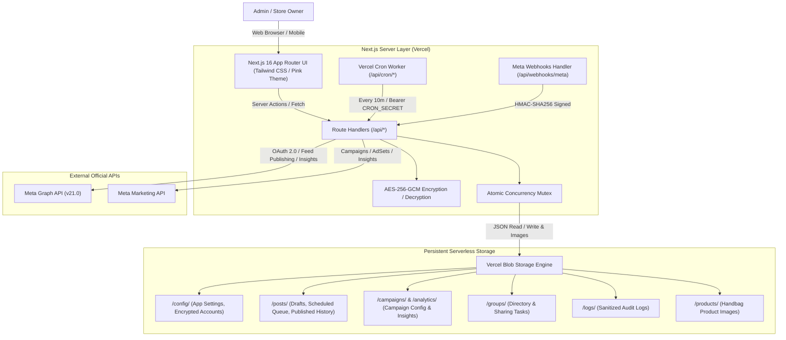

# Facebook Marketing Automation System (Cambodia Handbags)

An enterprise-grade, serverless Facebook Marketing Automation Dashboard designed specifically for an online luxury handbag business operating in Cambodia.

The system integrates directly and exclusively with the official **Meta Graph API (v21.0+)** and **Meta Marketing API**. It uses **Vercel Blob** as a persistent, serverless JSON data and media storage engine (strictly zero SQL/NoSQL databases, Prisma, or Supabase), and executes scheduled tasks via **Vercel Cron**.

---

## Table of Contents

1. [Executive Summary & Business Context](#1-executive-summary--business-context)
2. [High-Level Architecture](#2-high-level-architecture)
3. [Technology Stack](#3-technology-stack)
4. [Storage Engine (Vercel Blob Architecture)](#4-storage-engine-vercel-blob-architecture)
5. [Security & Token Encryption Model](#5-security--token-encryption-model)
6. [Dashboard Modules & Features](#6-dashboard-modules--features)
   - [Overview Command Center](#61-overview-command-center)
   - [Facebook Account Management](#62-facebook-account-management)
   - [Post Management Studio](#63-post-management-studio)
   - [Post Scheduler & Vercel Cron](#64-post-scheduler--vercel-cron)
   - [Facebook Advertising Management](#65-facebook-advertising-management)
   - [Advertising Analytics & CSV Export](#66-advertising-analytics--csv-export)
   - [Facebook Group Sharing Queue](#67-facebook-group-sharing-queue)
   - [Activity & Audit Logs](#68-activity--audit-logs)
   - [System Settings & Theming](#69-system-settings--theming)
7. [Meta Developer App Setup & Permissions](#7-meta-developer-app-setup--permissions)
8. [Internal API Reference (Route Handlers)](#8-internal-api-reference-route-handlers)
9. [Environment Variables Guide](#9-environment-variables-guide)
10. [Local Development Guide](#10-local-development-guide)
11. [Vercel Production Deployment & Cron Setup](#11-vercel-production-deployment--cron-setup)
12. [Troubleshooting & FAQ](#12-troubleshooting--faq)

---

## 1. Executive Summary & Business Context

Selling handbags online in Cambodia relies heavily on Facebook Pages, Meta Messenger for direct customer sales negotiations, and local community shopping groups. This system streamlines and automates this workflow:

- **Dual-Language Operations**: Supports dual **Khmer (ភាសាខ្មែរ)** and **English** product descriptions with presets tailored for Cambodian shoppers (free delivery in Phnom Penh, provincial bus delivery via Vireak Buntham, cash-on-delivery).
- **Dual Currency Support**: Real-time price conversion between **US Dollars ($)** and **Khmer Riel (៛)** using a configurable exchange rate (default: `1 USD = 4,100 KHR`).
- **Cambodia Time Standard**: All scheduling and reporting operate strictly in the **`Asia/Phnom_Penh` (UTC+7)** timezone to match local evening peak shopping hours (6:00 PM – 9:30 PM).
- **Zero Database Maintenance**: Operates completely serverless on Vercel Pro using JSON documents stored in `@vercel/blob` with atomic locking and zero cold-start database latency.
- **Financial Guardrails**: Built-in daily advertising spending safety caps to prevent unauthorized budget changes or accidental ad spend spikes.

---

## 2. High-Level Architecture



---

## 3. Technology Stack

- **Framework**: [Next.js 16 (App Router)](https://nextjs.org/) with React 19 and Turbopack.
- **Language**: TypeScript 5 (Strict Mode).
- **Styling**: Tailwind CSS v4, dynamic CSS theme variables (`pink`, `rose`, `purple`, `indigo`).
- **Icons**: Lucide React.
- **Storage**: `@vercel/blob` (Serverless persistent JSON & media files).
- **Validation**: Zod for type-safe runtime schema enforcement.
- **Security**: Node.js `crypto` (AES-256-GCM for token encryption, HMAC-SHA256 for session tokens and Meta webhook verification).
- **Scheduling**: Vercel Cron (configured via `vercel.json`).

---

## 4. Storage Engine (Vercel Blob Architecture)

The system does **NOT** use PostgreSQL, MySQL, MongoDB, Supabase, or Prisma. All persistent state is modeled as structured JSON documents and binary images in **Vercel Blob**.

### Blob Storage Hierarchy

| Path | Purpose | Sensitive Data Encrypted? |
| :--- | :--- | :---: |
| `/config/app-settings.json` | Brand theme, business name, currency, safety spending limits, Graph API version | No |
| `/config/facebook-accounts.json` | Connected user profile, accessible Pages, Ad Accounts, granted permissions | **Yes (AES-256-GCM)** |
| `/posts/drafts.json` | Unpublished handbag drafts, captions, pricing, image URLs | No |
| `/posts/scheduled.json` | Scheduled post queue with target execution timestamps and idempotency keys | No |
| `/posts/published.json` | Complete published history with Meta post IDs and Facebook permalinks | No |
| `/campaigns/campaign-config.json` | Advertising campaigns, Cambodian targeting presets, daily budgets | No |
| `/groups/group-list.json` | Catalog of Cambodian Facebook shopping groups and rules | No |
| `/groups/sharing-queue.json` | Policy-compliant 1-click manual sharing tasks | No |
| `/analytics/daily-reports.json` | Cached Meta Marketing API insights reports | No |
| `/logs/activity.json` | Audit trail of all administrative actions, cron runs, and API events | Sanitized |
| `/products/` | Uploaded handbag product photos | No (Public CDN) |

### Concurrency Protection & Local Development Fallback
- **Atomic Locking**: [`BlobStorageService.updateJson`](file:///d:/Own/facebook-control/src/lib/storage/blob-storage.ts) uses an in-process promise mutex queue to serialize concurrent writes to identical JSON files, preventing race conditions.
- **Local Fallback**: When running locally without `BLOB_READ_WRITE_TOKEN`, the system automatically reads and writes to `.blob-local/`, allowing full offline development and testing. Once deployed to Vercel, it switches automatically to cloud Vercel Blob without any code modifications.

---

## 5. Security & Token Encryption Model

### 1. Token Encryption at Rest
- Sensitive Facebook User Access Tokens and Page Access Tokens are **never** stored in plaintext.
- [`encryptToken()`](file:///d:/Own/facebook-control/src/lib/crypto.ts) encrypts tokens using **AES-256-GCM** with a 96-bit random Initialization Vector (IV) and a 128-bit authentication tag.
- The output format stored in Vercel Blob is:
  ```text
  <iv_hex>:<auth_tag_hex>:<ciphertext_hex>
  ```
- Decryption is performed in memory strictly on the server right before calling the Meta API.

### 2. Client-Side Sanitization
- Endpoint `/api/facebook/account` explicitly strips all raw and encrypted tokens before sending account metadata to the frontend. Access tokens never enter browser JavaScript.

### 3. Session Authentication & Admin Access
- Administrator access is guarded by signed session cookies (`fb_admin_session`) generated using HMAC-SHA256 with `SESSION_SECRET`.
- Next.js Proxy/Middleware ([`src/middleware.ts`](file:///d:/Own/facebook-control/src/middleware.ts)) intercepts requests, redirecting unauthenticated users to `/login`.

### 4. Meta Webhook Signature Verification
- Inbound webhook payloads from Meta are validated against the `X-Hub-Signature-256` header using HMAC-SHA256 with `META_APP_SECRET` to prevent request forgery.

### 5. Cron Secret Verification
- All automated endpoints under `/api/cron/*` verify the `Authorization: Bearer <CRON_SECRET>` header sent automatically by Vercel Cron.

---

## 6. Dashboard Modules & Features

### 6.1 Overview Command Center
- **Performance Cards**: Connected Facebook Pages, Total Published Posts, Scheduled Tasks, Active Advertising Campaigns, Ad Spend, Impressions, Reach, Clicks, and Messenger Leads.
- **Cambodia Time Clock**: Real-time Phnom Penh clock (`Asia/Phnom_Penh`) with UTC+7 indicator.
- **Date Filtering**: Today, Yesterday, Last 7 Days, Last 30 Days, All Time.
- **Failed Tasks Alert**: Direct inspection of any failed publishing attempts with error diagnostics.

### 6.2 Facebook Account Management
- **Meta OAuth 2.0**: Secure authentication flow with random CSRF `state` validation.
- **Page Selector**: Live switching between multiple managed Facebook Pages.
- **Permission Validator**: Live checklist verifying that critical scopes (`pages_manage_posts`, `pages_read_engagement`, `ads_management`, `business_management`) are granted.
- **Security Assurance**: Zero Facebook password storage guarantee.

### 6.3 Post Management Studio
- **Dual-Language Composer**: Side-by-side editing of Khmer and English captions with one-click copy presets for Cambodian handbag promotions.
- **Multi-Photo Uploader**: Multi-image drag-and-drop uploading to Vercel Blob with image thumbnail previews and reordering.
- **Price Tagging**: Dual-currency input (USD $ / KHR ៛) automatically embedded into the post text.
- **Live Feed Mockup**: Interactive desktop and mobile Facebook post preview showing Page avatar, captions, image gallery grid, and simulated Like/Comment/Share reactions.
- **Publishing History**: View all published posts with direct Facebook permalink buttons.

### 6.4 Post Scheduler & Vercel Cron
- **Target Time Picker**: Choose release dates and times locked to Cambodian local time.
- **Automated Cron Worker**: Runs every 10 minutes (`*/10 * * * *`) via Vercel Cron.
- **Task Resilience**: Idempotency keys prevent double posting; failed tasks are automatically retried up to 3 times with exponential backoff before being marked as failed.
- **Manual Trigger**: "Run Worker Now" button executes pending tasks on demand for immediate testing without waiting for the cron timer.

### 6.5 Facebook Advertising Management
- **Marketing API Integration**: View connected Ad Accounts, active campaigns, and budgets.
- **Cambodian Audience Targeting**: Pre-configured targeting for Phnom Penh, Siem Reap, Battambang, Women aged 18–45, interested in handbags and fashion accessories.
- **Campaign Objectives**: `OUTCOME_MESSAGES` (Chat to buy), `OUTCOME_TRAFFIC`, `OUTCOME_ENGAGEMENT`, `OUTCOME_SALES`.
- **Mandatory Admin Confirmation Modal**: Requires explicit checkbox confirmation before launching a new campaign, resuming a paused campaign, or increasing an advertising budget.
- **Daily Spending Limit**: Hard safety limit enforces a maximum allowable daily spend across all campaigns.

### 6.6 Advertising Analytics & CSV Export
- **Marketing Metrics**: Spend, Impressions, Reach, Clicks, Click-Through Rate (CTR %), Cost Per Click (CPC), Cost Per Thousand Impressions (CPM), and Cost Per Message Lead.
- **Visual Distribution**: Real-time visual comparison bars showing metric distribution across campaigns.
- **One-Click CSV Export**: Download formatted `.csv` reports for ad performance or published post history.

### 6.7 Facebook Group Sharing Queue
- **Meta Terms of Service Compliance**: Meta removed automated API posting to arbitrary groups in 2024. To prevent account bans or shadow-banning, the system provides a policy-compliant semi-automated workflow without headless scrapers or browser bots.
- **1-Click Sharing Tasks**: Pre-fills the handbag post caption, provides a one-click clipboard copy button, image URLs, and a direct link to open the Facebook Group in a new tab.
- **Group Catalog**: Categorized directory (Phnom Penh Market, Luxury Bags, Provincial Delivery) with posting rules and share counters.

### 6.8 Activity & Audit Logs
- Immutable audit log of all administrative actions (logins, post creation, cron publishing, campaign launches, budget changes).
- Automatically scrubs access tokens and secrets before writing to storage.
- Filterable by category (`auth`, `posts`, `ads`, `groups`, `cron`, `settings`) and status.

### 6.9 System Settings & Theming
- **Theme Color Switcher**: Choose from Pink (default brand), Rose Red, Purple Luxe, and Indigo Navy.
- **Spending Safety Cap**: Configure maximum daily ad spend threshold in USD.
- **Exchange Rate**: Set USD to KHR conversion rate.
- **Graph API Version**: Switch between `v21.0`, `v22.0`, etc.

---

## 7. Meta Developer App Setup & Permissions

To connect your real Facebook Page and Ad Account:

### Step 1: Create a Meta App
1. Go to the [Meta for Developers Portal](https://developers.facebook.com/).
2. Click **Create App** and select **Business** or **Other**.
3. Under App Settings > Basic:
   - Note your **App ID** and **App Secret**.
   - Set **App Domains** to your domain (e.g., `localhost` or `your-app.vercel.app`).

### Step 2: Configure Facebook Login for Business
1. Under Add Products, add **Facebook Login for Business**.
2. Under Facebook Login > Settings:
   - Set **Valid OAuth Redirect URIs**:
     - Local dev: `http://localhost:3000/api/facebook/callback`
     - Production: `https://<your-project>.vercel.app/api/facebook/callback`
   - Enable **Client OAuth Login** and **Web OAuth Login**.

### Step 3: Required Permissions Checklist

| Permission | Category | Purpose in System |
| :--- | :--- | :--- |
| `pages_show_list` | Pages | Discovers the Facebook Pages managed by the user |
| `pages_manage_posts` | Pages | Publishes, schedules, and edits handbag feed posts and photos |
| `pages_read_engagement` | Pages | Reads post likes, shares, comments, and engagement metrics |
| `pages_read_user_content`| Pages | Reads user comments on published handbag posts |
| `ads_management` | Ads | Creates campaigns, sets budgets, pauses, and resumes ads |
| `ads_read` | Ads | Retrieves advertising insights, spend, impressions, and CTR |
| `business_management` | Business | Accesses connected Ad Accounts under Meta Business Suite |
| `public_profile` | User | Identifies the authenticated store administrator |

---

## 8. Internal API Reference (Route Handlers)

All internal API routes are protected by administrator session authentication or Bearer authorization headers:

### Facebook Authentication & Pages
- `GET /api/facebook/connect` — Initiates Meta OAuth 2.0 flow with CSRF state protection.
- `GET /api/facebook/callback` — Exchanges authorization code for long-lived tokens and encrypts them.
- `POST /api/facebook/disconnect` — Clears stored Facebook credentials and wipes encrypted tokens.
- `GET /api/facebook/pages` — Returns accessible Facebook Pages without exposing tokens.
- `GET /api/facebook/account` — Returns sanitized connection status, token validity, and selected page.
- `PATCH /api/facebook/account` — Updates the active Facebook Page or Ad Account ID.

### Posts & Publishing
- `GET /api/posts` — Lists posts filtered by status (`draft`, `scheduled`, `published`, `failed`).
- `POST /api/posts` — Creates a new handbag post (save as draft or publish immediately).
- `GET /api/posts/[id]` — Retrieves single post details.
- `PATCH /api/posts/[id]` — Updates post captions, pricing, or media URLs.
- `DELETE /api/posts/[id]` — Deletes a draft or removes a post from history.
- `POST /api/posts/publish` — Publishes an existing draft or failed post directly to the Facebook Page.
- `POST /api/posts/schedule` — Queues a post for automated publication at a specified Cambodian time.
- `POST /api/posts/[id]/cancel` — Cancels a scheduled post and reverts it to drafts.

### Advertising Management
- `GET /api/ads/accounts` — Retrieves accessible Meta Ad Accounts.
- `GET /api/ads/campaigns` — Lists configured ad campaigns and daily spending safety limits.
- `POST /api/ads/campaigns` — Creates a new campaign in `PAUSED` state with Cambodian audience targeting.
- `GET /api/ads/campaigns/[id]` — Retrieves single campaign settings.
- `PATCH /api/ads/campaigns/[id]` — Modifies campaign settings (requires admin confirmation if increasing budget).
- `POST /api/ads/campaigns/[id]/launch` — Confirms and activates a campaign on Meta Marketing API.
- `POST /api/ads/campaigns/[id]/pause` — Pauses an active campaign.
- `POST /api/ads/campaigns/[id]/resume` — Resumes a paused campaign with confirmation check.
- `GET /api/ads/insights` — Fetches performance metrics from Meta Marketing API.

### Group Management
- `GET /api/groups` — Lists cataloged Cambodian shopping groups.
- `POST /api/groups` — Adds a new Facebook Group to the directory.
- `PATCH /api/groups/[id]` — Updates group rules and category.
- `DELETE /api/groups/[id]` — Deletes a group from the catalog.
- `GET /api/groups/queue` — Lists pending manual sharing tasks.
- `POST /api/groups/queue` — Assigns a handbag post to a group sharing queue.
- `POST /api/groups/queue/[id]` — Marks a task as completed or skipped.

### Analytics & Reporting
- `GET /api/dashboard/summary` — Aggregates overall performance metrics for the overview dashboard.
- `GET /api/analytics/posts` — Post engagement statistics.
- `GET /api/analytics/ads` — Comprehensive ad campaign breakdown.
- `GET /api/analytics/export` — Generates and downloads a `.csv` export (`?type=campaigns` or `?type=posts`).

### Automation & Background Workers
- `GET /api/cron/process-tasks` — Vercel Cron worker: scans scheduled queue and publishes due posts.
- `GET /api/cron/sync-analytics` — Daily Vercel Cron worker: synchronizes Marketing API insights.
- `GET /api/webhooks/meta` — Meta webhook verification challenge handler.
- `POST /api/webhooks/meta` — Processes incoming Meta webhook events (verifies HMAC SHA-256).

### Utilities & Auth
- `POST /api/auth/login` — Administrator password login.
- `POST /api/auth/logout` — Destroys admin session cookie.
- `GET /api/auth/me` — Checks current session state.
- `POST /api/upload` — Uploads handbag product photos to Vercel Blob.
- `GET /api/settings` & `PATCH /api/settings` — Reads and updates app configuration.
- `GET /api/logs` — Reads immutable audit logs.

---

## 9. Environment Variables Guide

Prepare your `.env.local` file based on `.env.example`:

```ini
# =================================================================
# Meta / Facebook Developer App Credentials
# =================================================================
META_APP_ID=your_facebook_app_id
META_APP_SECRET=your_facebook_app_secret
META_GRAPH_API_VERSION=v21.0
META_REDIRECT_URI=http://localhost:3000/api/facebook/callback

# =================================================================
# Security & Token Encryption Keys (Must be at least 32 characters)
# =================================================================
TOKEN_ENCRYPTION_KEY=super_secret_32_character_encryption_key_here!
ADMIN_PASSWORD=admin1234
SESSION_SECRET=session_signature_secret_at_least_32_characters_long

# =================================================================
# Vercel Cron Secret (Matches Authorization header in Vercel Cron)
# =================================================================
CRON_SECRET=your_secure_cron_secret_string

# =================================================================
# Vercel Blob Storage Token (Obtained from Vercel Project > Storage)
# Leave blank in local development to use automatic .blob-local fallback
# =================================================================
BLOB_READ_WRITE_TOKEN=

# =================================================================
# Application URLs
# =================================================================
APP_URL=http://localhost:3000
NEXT_PUBLIC_APP_URL=http://localhost:3000
```

---

## 10. Local Development Guide

### Prerequisites
- Node.js 18.18+ or Node.js 20+ (tested on Node.js 25)
- npm 10+ or npm 11+

### Installation & Run
```bash
# 1. Clone the repository
git clone https://github.com/HoeunPichet/facebook-control.git
cd facebook-control

# 2. Install dependencies
npm install

# 3. Configure environment variables
cp .env.example .env.local

# 4. Start local development server
npm run dev
```

Open [http://localhost:3000](http://localhost:3000) in your browser and log in with password `admin1234`.

### Testing Workflows Locally
1. **Local Media & Blob**: Without `BLOB_READ_WRITE_TOKEN`, uploaded handbag images and JSON state are saved to `.blob-local/` automatically.
2. **Manual Cron Execution**: Navigate to `/scheduler` and click **Run Worker Now** to execute scheduled tasks immediately without waiting for Vercel Cron.
3. **Type Checking & Production Build**:
   ```bash
   npx tsc --noEmit
   npm run build
   ```

---

## 11. Vercel Production Deployment & Cron Setup

Deploying to Vercel takes less than 3 minutes:

### 1. Push to GitHub
```bash
git add .
git commit -m "Deploy Facebook Marketing Automation System"
git push origin main
```

### 2. Import into Vercel
1. Go to [vercel.com/new](https://vercel.com/new) and select the repository `facebook-control`.
2. Framework Preset: **Next.js**.

### 3. Attach Vercel Blob Storage
1. In your Vercel Project, navigate to the **Storage** tab.
2. Click **Create Database** > **Blob**.
3. Choose a store name (e.g. `handbag-marketing-blob`) and attach it to your project.
4. Vercel will automatically configure the `BLOB_READ_WRITE_TOKEN` environment variable.

### 4. Configure Production Environment Variables
Under **Project Settings > Environment Variables**, add:
- `META_APP_ID`: Your Meta App ID.
- `META_APP_SECRET`: Your Meta App Secret.
- `META_GRAPH_API_VERSION`: `v21.0`.
- `META_REDIRECT_URI`: `https://<your-project>.vercel.app/api/facebook/callback`.
- `TOKEN_ENCRYPTION_KEY`: A secure 32-character random string.
- `ADMIN_PASSWORD`: Your chosen secure dashboard password.
- `SESSION_SECRET`: A secure 32-character random string.
- `CRON_SECRET`: A secure secret string.
- `APP_URL`: `https://<your-project>.vercel.app`.

### 5. Deploy & Verify Cron Jobs
Click **Deploy**. Once built, Vercel will automatically read [`vercel.json`](file:///d:/Own\facebook-control\vercel.json) and register the cron jobs:
- `/api/cron/process-tasks` scheduled for `*/10 * * * *` (every 10 minutes).
- `/api/cron/sync-analytics` scheduled for `0 0 * * *` (midnight daily).

You can monitor cron executions directly in **Vercel Dashboard > Project Settings > Cron Jobs**.

---

## 12. Troubleshooting & FAQ

#### Q: How does post scheduling work without an always-on server?
> Vercel functions are serverless. Vercel Cron makes an automated HTTP GET request to `/api/cron/process-tasks` every 10 minutes with the secret Bearer token. The handler checks `/posts/scheduled.json`, publishes any posts whose scheduled time in Cambodia has arrived, moves them to published history, and exits.

#### Q: What happens if an access token expires?
> Long-lived user access tokens obtained through our exchange flow are valid for approximately 60 days. The Facebook Accounts dashboard displays token expiration dates and warns you when a refresh or re-connection is needed.

#### Q: Why can't the system automatically publish to arbitrary Facebook Groups?
> In 2024, Meta completely deprecated the Groups API permissions for external apps to auto-publish to groups. Using unofficial browser bots (Selenium/Puppeteer) or cookie hijacking violates Meta Terms of Service and leads to permanent Page bans. Our system provides a 1-click clipboard task queue that enables swift manual posting while staying 100% compliant.

#### Q: How are tokens protected against data leaks?
> All tokens are encrypted using AES-256-GCM before being saved in Vercel Blob. Even if someone obtains the raw JSON document, the tokens cannot be decrypted without the private `TOKEN_ENCRYPTION_KEY` stored exclusively in Vercel environment variables. Furthermore, API endpoints scrub all tokens before delivering responses to the frontend.

---

## 📄 License

Proprietary enterprise software built for Cambodia Luxury Handbag Marketing Automation. All rights reserved.
